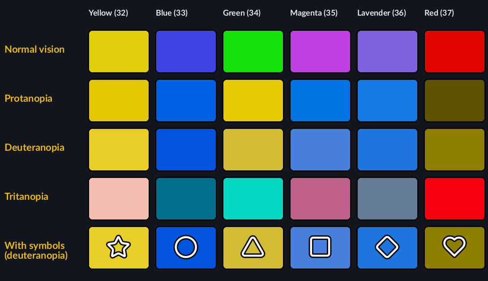

# Colour-blind options for the bricks: first look (2026-11-14)

Part of the accessibility work the owner put alongside Rescue (docs/ROADMAP.md, "Current priorities"). Nothing in the game is changed yet; this note sets out what the problem is and the ways to solve it, for the owner to choose.

## The problem, measured

The six brick colours (block types 32 to 37) were shown side by side on the sphere (`BLOCKPLANET_MINEFIELD_STRIPES=1`, a research switch in Minefield), sampled from the picture, and run through the standard simulations of the three common kinds of colour blindness (Machado, Oliveira and Fernandes 2009, full strength, in linear light).

- **Red-green colour blindness (protanopia and deuteranopia, about 1 man in 12):** yellow and green become almost the same colour, and blue, magenta and lavender become three similar blues. Red turns a dark olive. Of six colours, only about three can be told apart. This is the one that matters most.
- **Blue-yellow colour blindness (tritanopia, rare):** the colours stay distinct (pink, teal, aqua, rose, grey, red), though they change.

Matching by colour is the whole game, so for about one player in twelve the sphere is close to unplayable as it is.

## Ways to fix it

1. **A symbol on each colour** (the last row above: star, circle, triangle, square, diamond, heart). Works for every kind of colour blindness, and also helps on small screens and in poor light. It needs each brick colour's texture sheet to carry its symbol: drawn from the player's own game at install time (the colours' sheets stay the game's), with BlockPlanet's own symbols laid over the bricks' faces, or drawn with the bricks by BlockPlanet's sphere drawing, as Minefield's numbers are. Most work of the three; the clearest result.
2. **A colour-blind palette:** change the six colours to ones that stay apart for red-green colour blindness (for example blue, orange, white, black, yellow and a dark red). Cheap (the colours come from each type's texture sheet, which can be tinted as it loads), but it changes the game's look for everyone who turns it on, and six colours can never all stay apart for every kind of colour blindness at once.
3. **Patterns instead of symbols:** stripes, dots, checks, plain. Subtler than symbols; harder to read on a small, turning sphere.

The usual choice in puzzle games is 1, often with 2 as an extra. The HUD's colours (hearts, bars, the Next pieces) and Minefield's numbers need the same care; they are BlockPlanet's own and easy to change.

## Questions for the owner

1. **Symbols, palette or both?** Recommended: symbols, with an optional palette.
2. **Which symbols?** The six above are a placeholder set; any simple shapes that read at a glance work.
3. **On all the time, or an option?** Recommended: an option in Options > Accessibility, off by default, with the palette as a second option.
